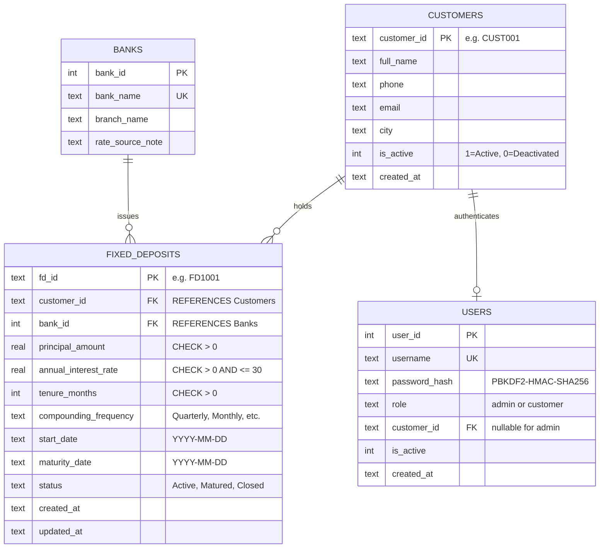

# FD Manager — Fixed Deposit Portfolio Management System

**Fixed Deposit (FD) Manager** is a complete, desktop application built in Python and SQLite for managing multiple individuals' fixed deposit portfolios across Indian commercial banks.

Developed for academic demonstration in **Database Management Systems (DBMS)**, this project illustrates real-world database architecture integrated with an interactive Graphical User Interface (GUI). It demonstrates relational schema design, primary and foreign key constraints, parameterized CRUD operations, SQL joins, aggregate reporting, transactional consistency, role-based authorization, and compound interest forecasting.

---

## 1. System Features & Highlights

- **Desktop GUI**: Built with Python Tkinter and custom `ttk` styling featuring a dark navy sidebar navigation (`#0F172A`), KPI dashboard cards, sortable data tables with zebra striping, search bars, and filter dropdowns.
- **Relational SQLite Database**: Persistent ACID storage utilizing `PRAGMA foreign_keys = ON`, `CHECK` constraints, unique constraints, and optimized indexes.
- **Multi-Role Authentication**:
  - **Administrator**: Full administrative control across all customers, global fixed deposits, centralized analytics charts, customer account deactivation/reactivation, deposit closure, and global reporting.
  - **Individual Customer**: Strict data isolation enforced at the SQL query and application layer. Customers can only view, filter, calculate, and export their own personal fixed deposit portfolio.
- **Preloaded Synthetic Demonstration Data**: Automatically seeds 20 fictional Indian customers, 20 customer login accounts, 4 sample Indian commercial banks, an admin account, and 38 realistic fixed deposit records spanning Active, Matured, and Closed statuses. Seeding is completely idempotent.
- **Interactive FD Maturity Calculator**: Mathematical engine supporting **Quarterly**, **Monthly**, **Half-Yearly**, and **Annual** compounding with live dynamic previews, frequency comparison matrix, and date forecasting.
- **Embedded Analytics**: Real-time Matplotlib charts embedded in the Admin Dashboard (Bank-wise investment distribution donut chart, Status breakdown pie chart, and Principal vs Returns comparison).
- **Comprehensive Reporting & CSV Export**: 10 distinct parameterized reports exportable to Excel-compatible CSV (UTF-8-SIG encoding).

---

## 2. Technology Stack & Prerequisites

- **Python Version**: Python 3.10 or higher (Tested on Python 3.13 on Windows).
- **Core GUI**: Tkinter & TTK (Standard Library).
- **Database**: SQLite 3 using Python's built-in `sqlite3` library.
- **Data Visualization**: Matplotlib (`matplotlib>=3.7.0`).
- **Security**: PBKDF2-HMAC-SHA256 with 16-byte cryptographic salt (Standard Library `hashlib` & `secrets`).
- **Exporting**: Python standard library `csv` module with UTF-8-SIG formatting.
- **Testing**: Python standard library `unittest` framework.

---

## 3. Installation & Setup

### Step 1: Open Terminal in Project Directory
Navigate to the project root directory:
```powershell
cd "C:\Users\tanis\.gemini\antigravity\scratch\fd_manager"
```

### Step 2: Install Dependencies
Install the required charting library:
```powershell
pip install -r requirements.txt
```
*(All other modules are part of Python's standard library).*

### Step 3: Run the Application
Launch the desktop application:
```powershell
python main.py
```

### Step 4: Run Automated Test Suite
To verify database constraints, calculation formulas, customer isolation, and GUI rendering:
```powershell
python run_tests.py
```
*(Runs 19 automated unit and GUI smoke tests).*

---

## 4. Demonstration Login Credentials

The system seeds default credentials on first launch. For maximum convenience, the login screen also includes **one-click autofill buttons**:

| Role | Username | Password | Access Scope |
| :--- | :--- | :--- | :--- |
| **Administrator** | `admin` | `AdminPassword@123` | Global access: All customers, all FDs, all reports, analytics |
| **Demo Customer 1** | `cust001` | `Customer@123` | Aarav Sharma (Delhi) — Only their 2 FDs |
| **Demo Customer 2** | `cust002` | `Customer@123` | Priya Verma (Lucknow) — Only their 2 FDs |
| **Demo Customer 3** | `cust003` | `Customer@123` | Rahul Gupta (Jaipur) — Only their 2 FDs |
| **Demo Customers 4–20** | `cust004` to `cust020` | `Customer@123` | Individual customers strictly isolated to their own portfolios |

---

## 5. Database Architecture & Schema

The application uses an SQLite relational database (`fd_manager.db`) with four primary entities:



### Constraints & Integrity Rules:
1. **Foreign Keys**: Enforced using `PRAGMA foreign_keys = ON;`. Deleting a customer with active deposits is blocked by `ON DELETE RESTRICT`.
2. **Check Constraints**:
   - `principal_amount > 0`: Rejects non-positive investments.
   - `annual_interest_rate > 0 AND annual_interest_rate <= 30`: Rejects unrealistic interest rates.
   - `tenure_months > 0`: Rejects zero or negative durations.
   - `status IN ('Active', 'Matured', 'Closed')`: Enforces consistent lifecycle states.
3. **Indexes**:
   - `idx_fd_customer_id` on `FixedDeposits(customer_id)`
   - `idx_fd_bank_id` on `FixedDeposits(bank_id)`
   - `idx_fd_maturity_date` on `FixedDeposits(maturity_date)`
   - `idx_fd_status` on `FixedDeposits(status)`
   - `idx_cust_city` on `Customers(city)`

---

## 6. Seeded Indian Customer Profiles (20 Customers)

The application automatically provisions the following 20 fictional Indian customers:

1. **Aarav Sharma** (`CUST001`) — Delhi — `aarav.sharma@demo-fd.in`
2. **Priya Verma** (`CUST002`) — Lucknow — `priya.verma@demo-fd.in`
3. **Rahul Gupta** (`CUST003`) — Jaipur — `rahul.gupta@demo-fd.in`
4. **Neha Singh** (`CUST004`) — Chandigarh — `neha.singh@demo-fd.in`
5. **Arjun Patel** (`CUST005`) — Ahmedabad — `arjun.patel@demo-fd.in`
6. **Ananya Mishra** (`CUST006`) — Varanasi — `ananya.mishra@demo-fd.in`
7. **Rohan Kumar** (`CUST007`) — Patna — `rohan.kumar@demo-fd.in`
8. **Sneha Yadav** (`CUST008`) — Kanpur — `sneha.yadav@demo-fd.in`
9. **Vikram Mehta** (`CUST009`) — Mumbai — `vikram.mehta@demo-fd.in`
10. **Pooja Agarwal** (`CUST010`) — Agra — `pooja.agarwal@demo-fd.in`
11. **Aditya Joshi** (`CUST011`) — Pune — `aditya.joshi@demo-fd.in`
12. **Kavya Reddy** (`CUST012`) — Hyderabad — `kavya.reddy@demo-fd.in`
13. **Karan Malhotra** (`CUST013`) — Amritsar — `karan.malhotra@demo-fd.in`
14. **Simran Kaur** (`CUST014`) — Ludhiana — `simran.kaur@demo-fd.in`
15. **Aman Tiwari** (`CUST015`) — Bhopal — `aman.tiwari@demo-fd.in`
16. **Isha Kapoor** (`CUST016`) — Noida — `isha.kapoor@demo-fd.in`
17. **Suresh Nair** (`CUST017`) — Kochi — `suresh.nair@demo-fd.in`
18. **Meera Desai** (`CUST018`) — Surat — `meera.desai@demo-fd.in`
19. **Deepak Choudhary** (`CUST019`) — Jodhpur — `deepak.choudhary@demo-fd.in`
20. **Riya Saxena** (`CUST020`) — Dehradun — `riya.saxena@demo-fd.in`

### Participating Commercial Banks:
1. **State Bank of India (SBI)** — Nariman Point Branch, Mumbai (Sample Academic Rate: 6.50% – 7.10%)
2. **HDFC Bank** — Connaught Place Branch, New Delhi (Sample Academic Rate: 6.60% – 7.25%)
3. **ICICI Bank** — Bandra-Kurla Complex Branch, Mumbai (Sample Academic Rate: 6.70% – 7.20%)
4. **Punjab National Bank (PNB)** — Sector 17 Branch, Chandigarh (Sample Academic Rate: 6.50% – 7.30%)

---

## 7. FD Maturity Calculation Engine & Assumptions

### Compound Interest Formula:
$$A = P \times \left(1 + \frac{r}{100 \times n}\right)^{n \times t}$$

Where:
- $P$ = Principal deposit amount in Indian Rupees (₹).
- $r$ = Annual interest rate in percent (e.g., $7.10\%$).
- $n$ = Compounding frequency per annum ($4$ for Quarterly, $12$ for Monthly, $2$ for Half-Yearly, $1$ for Annually).
- $t$ = Tenure in years, calculated as $\text{tenure\_months} / 12.0$.
- $A$ = Estimated total maturity amount.
- $\text{Estimated Interest} = A - P$.

### Automatic Status Determination:
- **Active**: Maturity date is strictly in the future (`maturity_date > today`) and deposit is not closed.
- **Matured**: Maturity date has arrived or passed (`maturity_date <= today`) and deposit is not closed.
- **Closed**: Deposit has been explicitly closed by administrator. A manually closed status is **never overwritten** by automatic maturity checks, preserving full historical records.

### Academic Notice:
All calculations are estimates for educational and portfolio tracking purposes based on standard compound interest mathematics. Actual banking payouts may differ slightly due to individual bank day-count conventions (365 vs 366 days in leap years), premature withdrawal penalty clauses, TDS deductions, and specific bank rules.

---

## 8. Reports Included (10 Reports)

The reporting module (`ui/reports.py`) provides 10 standard reports with 1-click CSV export:

1. **Complete Customer Directory**: Full directory with contact info, account status, total FDs, and total principal.
2. **Customer-Wise FD Portfolio**: Granular listing of all deposits with calculated maturity amounts and interest returns.
3. **Bank-Wise Investment Report**: Aggregated deposit count, active/matured/closed breakdown, and total principal by bank.
4. **Active Fixed Deposits Report**: All currently active deposits accruing interest.
5. **Matured Fixed Deposits Report**: All completed deposits awaiting settlement or reinvestment.
6. **Closed Fixed Deposits Report**: Historical log of prematurely closed or settled deposits.
7. **Upcoming Maturity Report**: Deposits maturing within the next 30 days for proactive reinvestment.
8. **Date-Range Maturity Report**: Filter deposits maturing between any two chosen dates (DD-MM-YYYY).
9. **Portfolio Investment Summary**: High-level financial KPIs (Total principal, active principal, matured principal, average interest rate).
10. **Estimated Returns Summary**: Tenure bucket analysis ($\le 12$ months, $13$–$24$ months, $25$–$36$ months, $>36$ months).

---

## 9. DBMS Concepts Demonstrated

| Relational DBMS Concept | Implementation in FD Manager |
| :--- | :--- |
| **Relational Schema Design** | 4 normalized tables (`Customers`, `Users`, `Banks`, `FixedDeposits`) with 1-to-1 and 1-to-many relationships. |
| **Referential Integrity** | `PRAGMA foreign_keys = ON;`, `FOREIGN KEY ... REFERENCES Customers(customer_id) ON DELETE RESTRICT`. |
| **Domain Constraints** | `CHECK(principal_amount > 0)`, `CHECK(annual_interest_rate > 0 AND annual_interest_rate <= 30)`, `CHECK(is_active IN (0, 1))`. |
| **Query Optimization** | 6 B-Tree indexes on foreign keys, maturity dates, and status fields. |
| **Multi-Table JOINs** | 3-table `INNER JOIN` (FixedDeposits + Customers + Banks) and `LEFT JOIN` for directory aggregates. |
| **Aggregations & Grouping** | `COUNT()`, `SUM()`, `AVG()`, `MIN()`, `MAX()`, `GROUP BY b.bank_id`, `COALESCE()`. |
| **ACID Transactions** | Python context manager (`get_db_connection()`) wrapping multi-record operations with automatic `commit()` and `rollback()`. |
| **Data Protection & Access Control** | PBKDF2 password hashing; SQL queries strictly parameterized and restricted by `customer_id` for customer sessions. |

*(See `sql_examples.sql` for standalone, commented SQL demonstrations).*

---

## 10. How to Safely Reset the Demo Database

If you wish to restore the database to its pristine demo state:

1. Close the running application.
2. Delete the `fd_manager.db` file in the project folder:
   ```powershell
   Remove-Item "C:\Users\tanis\.gemini\antigravity\scratch\fd_manager\fd_manager.db"
   ```
3. Run `python main.py` or `python seed_data.py`. The database schema, indexes, admin account, 20 Indian customers, 4 banks, and 38 sample deposits will be automatically re-created.
